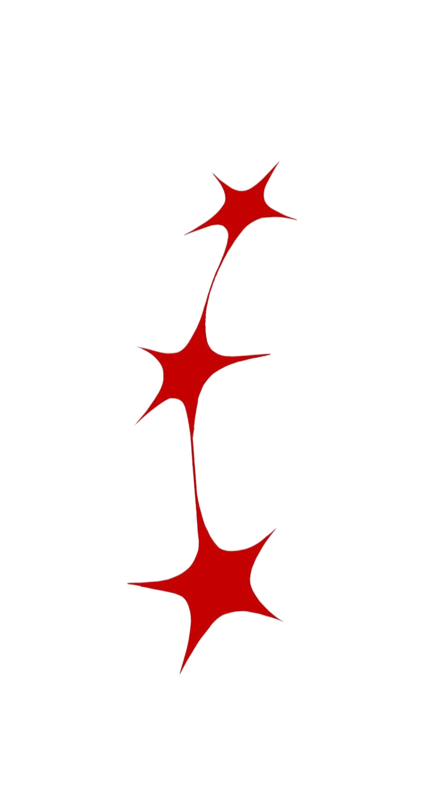

<table align="center">
<tr>
<td align="right"><h1>Pavan Badiger</h1></td>
<td align="left"></td>
</tr>
</table>

**AI & Data Science student · builder · curious mind**

 

<video src="assets/Gif.gif" width="680" height="240" autoplay loop muted playsinline controls aria-label="Pavan Badiger intro animation" style="width: 680px; max-width: 100%; height: 240px; object-fit: cover; border-radius: 16px;"></video>

## About

I’m a student developer from Belagavi, India, interested in turning ideas into useful software. I explore AI/ML, cybersecurity, automation, full-stack web development, Linux, and embedded systems through practical projects.

Currently learning, building, and looking for meaningful collaborations.

## Skills

## Selected work

| Project | What it is |
| --- | --- |
| [GhostFiles](https://github.com/Pavn31/GhostFiles) | Lightweight, privacy-conscious file management and sharing. |
| [Smart Blind Stick](https://github.com/Pavn31/Smart-Blind-Stick) | Arduino assistive technology with obstacle detection and alerts. |
| [Portfolio](https://github.com/Pavn31/Portfolio) | A cinematic personal space for projects and experiments. |

## Contact

Building with curiosity. Improving with every commit.

